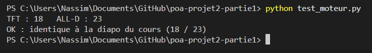
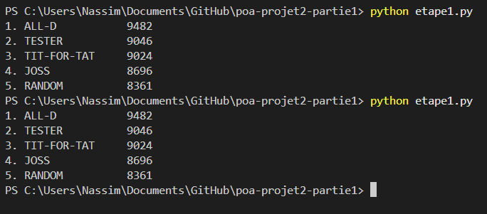
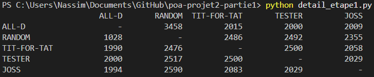
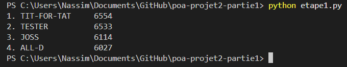
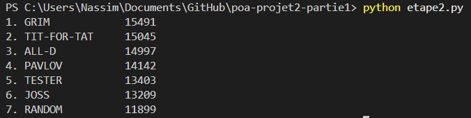
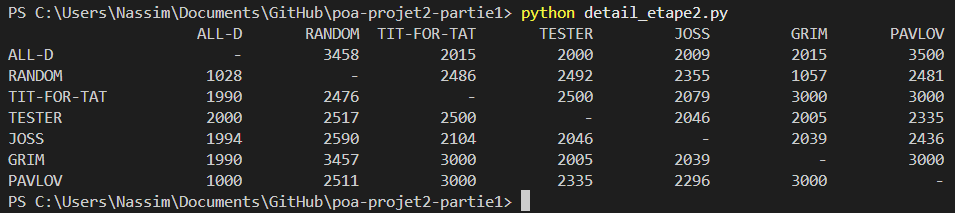
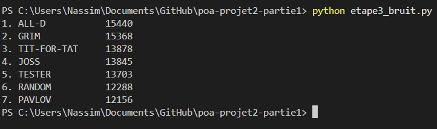
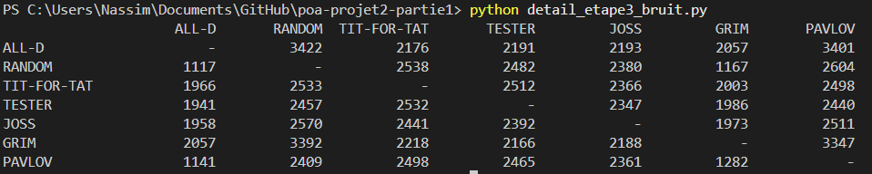
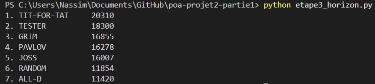
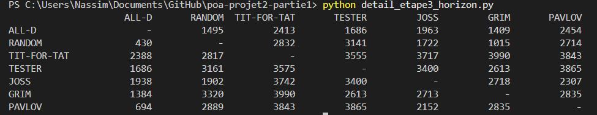

# Journal de bord - Projet 2 (partie 1)

HAI716I, tournoi d'Axelrod modifié.

## Objectif

Coder un tournoi de dilemme du prisonnier itéré, faire jouer des stratégies entre elles et expliquer les classements.

## Plan

D'abord le moteur et les 5 stratégies du cours (ALL-D, RANDOM, TIT-FOR-TAT, TESTER, JOSS), pour voir si TIT-FOR-TAT gagne. Ensuite j'ajoute 2 stratégies hors cours et je compare. Enfin je modifie 2 règles du tournoi, en notant ma prédiction avant de lancer.

## Protocole

Chaque paire de stratégies joue 5 parties de 200 tours, comme dans le tournoi d'Axelrod du cours, avec les gains du sujet (CC = 3/3, CD = 0/5, DC = 5/0, DD = 2/2). Une stratégie ne joue pas contre elle-même, parce que le sujet dit "chaque autre". La graine aléatoire est fixée à 42 pour que les résultats soient les mêmes à chaque lancement.

Pour l'étape 3, je garde les 7 stratégies de l'étape 2, la même graine et je teste deux modifs, une à la fois :
- du bruit : chaque coup a 5 % de chances d'être inversé. Je le prends parce que dans le cours on voit que TFT gère mal les erreurs, et je veux voir ce que font GRIM et PAVLOV.
- un horizon inconnu : après chaque tour, la partie continue avec une proba de 0,995. Ça fait 200 tours en moyenne, comme avant, donc je peux comparer. Je le prends à cause de la récurrence à rebours du cours.

Je fais les deux modifs séparément, pour pouvoir comparer chaque résultat au classement de l'étape 2 et savoir quel effet vient de quelle modif.

Je ne prends pas la sélection, à cause de mon problème de scores rangés par nom (voir Impasses).

## Stratégies

**ALL-D** vient du cours : elle joue toujours D, c'est la stratégie "rationnelle" de la récurrence à rebours. Je pense qu'elle va bien s'en sortir contre ceux qui coopèrent sans jamais punir, comme RANDOM, puisqu'elle prend 5 à chaque fois que l'autre joue C. Par contre contre ceux qui ripostent, elle gagne le premier tour puis ne prend plus que 2 par tour.

**TIT-FOR-TAT** vient aussi du cours, c'est celle qui a gagné le tournoi d'Axelrod en 1980 : elle commence par C puis copie le dernier coup de l'adversaire. Je m'attends à ce qu'elle marche bien contre les stratégies qui coopèrent, et contre ALL-D elle ne se fait avoir qu'une fois. Par contre elle ne peut jamais battre son adversaire en duel, au mieux elle fait égalité.

**RANDOM** vient du cours : elle joue C ou D au hasard, une chance sur deux. Elle sert de témoin, pour voir si les autres font mieux que le hasard. Je pense qu'elle va finir dernière, parce qu'elle ne punit jamais et ne récompense jamais, donc tout le monde peut l'exploiter, surtout ALL-D.

**TESTER** vient du cours : elle commence par D pour tester l'adversaire. Si l'adversaire riposte, elle passe en TIT-FOR-TAT, sinon elle répète C, C, D pour l'exploiter. La diapo ne dit pas exactement ce que veut dire "riposter", j'ai pris "l'adversaire a joué D au moins une fois". Je m'attends à ce qu'elle profite des stratégies naïves, mais contre TIT-FOR-TAT son D du premier tour risque de déclencher des représailles.

**JOSS** vient du cours : c'est TIT-FOR-TAT, mais une fois sur dix elle remplace son C par un D. Dans le code, elle hérite de TIT-FOR-TAT et ne fait que modifier son coup. Je pense qu'elle gagne un peu contre ceux qui ne punissent pas, mais contre TIT-FOR-TAT chaque trahison va lancer un échange de représailles qui coûte des points aux deux.

**GRIM** ne vient pas du cours, c'est la stratégie de l'économiste Friedman (1971)(aussi appelée "Grim Trigger"). Elle coopère tant que l'adversaire n'a jamais trahi, mais dès la première trahison elle trahit pour toujours, sans jamais pardonner. Je pense qu'elle va bien marcher contre TIT-FOR-TAT, avec qui elle coopérera tout le long. Contre ALL-D, elle se fait avoir une seule fois, comme TFT. Par contre, contre JOSS et RANDOM, une seule trahison au hasard suffit pour qu'elle trahisse jusqu'à la fin, donc elle risque de perdre beaucoup de points à cause de sa rancune.

**PAVLOV** ne vient pas du cours non plus, elle a été rendue célèbre par Nowak et Sigmund (1993) (aussi appelée "win-stay, lose-shift"). Elle commence par C, puis si son dernier coup lui a rapporté 3 ou 5 elle le rejoue, sinon elle change. Je pense qu'elle va bien coopérer avec TFT et GRIM. Par contre, contre ALL-D elle va alterner : elle prend 0, passe à D, prend 2, repasse à C, et ainsi de suite, donc elle va perdre des points en revenant tout le temps coopérer. Contre RANDOM, quand elle trahit un C elle garde D, donc elle peut l'exploiter un peu.

## Suivi

### Vendredi 13/11

#### Compréhension du sujet

J'ai lu le sujet et le cours 4. J'ai créé le dépôt, le README et le journal.
Pour le langage, j'ai choisi Python (plus à l'aise).

#### Etape 1

J'ai écrit le moteur : une fonction `partie` qui fait jouer deux stratégies pendant un nombre de tours donné, et une fonction `tournoi` qui fait jouer tout le monde contre tout le monde. J'ai fixé les paramètres du tournoi au passage (voir protocole).

### Samedi 14/11

J'ai fait une classe par stratégie avec une méthode `jouer(mes_coups, coups_adv, rng)` qui renvoie C ou D. J'ai mis ALL-D et TIT-FOR-TAT.

J'ai hésité à faire des fonctions à la place des classes, vu que l'historique est donné à chaque tour, les stratégies n'ont pas besoin de garder un état. Mais j'ai quand meme décider de garder les classes : le nom est rangé avec la stratégie (et en prévision JOSS pourra hériter de TFT).

Pour vérifier le moteur, je refais l'exemple du cours : TFT contre ALL-D sur 10 tours. Je trouve 18 pour TFT et 23 pour ALL-D, pareil que la diapo.

J'ai ajouté les 3 stratégies du cours qui manquaient : RANDOM, TESTER et JOSS (voir le détail dans la section Stratégies).

J'ai lancé le tournoi avec les 5 stratégies et une graine 42. Je l'ai lancé deux fois et j'ai exactement le même classement, donc la graine marche.

TIT-FOR-TAT gagne-t-il ? 
Non, il finit 3e. C'est ALL-D qui gagne, TESTER est 2e juste devant TFT (22 points d'écart, presque rien).

En regardant les scores match par match, je vois qu'ALL-D gagne surtout grâce à RANDOM : contre les autres elle fait environ 2 par tour, mais contre RANDOM elle prend 5 une fois sur deux (3458 points contre RANDOM, environ 2000 contre chacun des autres). Mon hypothèse : sans RANDOM, ALL-D ne gagnerait plus.

La différence avec 1980 vient de la population. Ici TFT est la seule stratégie qui ne trahit jamais en premier, donc elle n'a personne avec qui coopérer à 3 par tour. En plus, TESTER et JOSS la piègent dans des échanges de représailles : contre TESTER elle fait 2500 au lieu de 3000, parce que TESTER commence par D, TFT riposte, et les deux se renvoient la trahison toute la partie. En 1980 il y avait 14 programmes, et beaucoup étaient "gentils" (ils ne trahissent jamais en premier), c'est avec eux que TFT faisait ses points. C'est ce que dit le cours : TFT marche seulement si elle rencontre assez de stratégies qui pensent comme elle.

### Dimanche 15/11

Pour vérifier, j'ai relancé le tournoi sans RANDOM (ligne en commentaire dans `etape1.py`). TFT passe 1re et ALL-D tombe dernière : l'hypothèse est confirmée, ALL-D gagnait grâce aux points pris contre RANDOM. TFT ne gagne que de 21 points devant TESTER, donc ça reste serré.

#### Étape 2

J'ajoute 2 stratégies qui ne sont pas dans le cours : GRIM et PAVLOV (voir le détail dans la section Stratégies). Je les ai choisies parce qu'elles sont toutes les deux "gentilles" comme TFT, mais avec deux idées opposées : GRIM ne pardonne jamais, PAVLOV se corrige selon ce que son coup lui a rapporté. D'après ce que j'ai vu à l'étape 1, avoir plus de stratégies gentilles devrait aider TFT, puisqu'elle aura enfin des partenaires avec qui coopérer.

J'ai lancé le tournoi avec les 7 stratégies, toujours avec la graine 42.

C'est GRIM qui gagne, TFT est 2e et ALL-D tombe 3e. Par rapport à l'étape 1, TFT passe de 3e à 2e et ALL-D perd la 1re place.

Comme je l'avais prévu, ajouter des stratégies gentilles aide TFT : contre GRIM et contre PAVLOV elle fait 3000, c'est-à-dire qu'elles coopèrent tout le long, à 3 par tour. Tous les matchs entre TFT, GRIM et PAVLOV finissent à 3000 des deux côtés.

Par contre je me suis trompé sur GRIM. Je pensais que sa rancune allait lui faire perdre beaucoup de points contre RANDOM, mais c'est l'inverse, c'est même son meilleur match (3457). Dès que RANDOM trahit une fois, GRIM trahit pour toujours, donc elle joue comme ALL-D et prend 5 à chaque fois que RANDOM joue C. TFT, lui, continue de copier RANDOM et lui pardonne, il ne fait que 2476. C'est presque toute la différence entre GRIM et TFT au classement. Donc ne jamais pardonner, ici, ça paye contre une stratégie qui trahit au hasard.

Pour PAVLOV, j'avais raison contre ALL-D : elle alterne C et D, prend 0 puis 2, donc 1 par tour en moyenne (1000 points). Mais je n'avais pas vu que ça profite aussi à ALL-D, qui fait 3500 contre elle, son meilleur match avec celui contre RANDOM. C'est ce qui permet à ALL-D de rester 3e alors qu'elle fait environ 2000 contre tous les autres.

En résumé, à l'étape 1 TFT perdait parce qu'elle n'avait personne avec qui coopérer. Avec deux gentilles en plus, les stratégies qui coopèrent passent devant, mais celle qui gagne est celle qui sait aussi punir pour de bon ceux qui trahissent (GRIM).

#### Étape 3 : prédictions (écrites avant de lancer)

Bruit : je pense que les gentilles vont perdre pas mal de points entre elles. Avec TFT, une erreur suffit pour lancer un écho de représailles, comme dans la diapo du cours. GRIM devrait chuter le plus : avec 5 % d'erreurs, il y aura vite une trahison par accident, et après elle trahit pour toujours, même contre TFT et PAVLOV. Je pense qu'elle perd sa 1re place. PAVLOV devrait mieux tenir, parce qu'après un D/D elle repasse à C toute seule. ALL-D trahit de toute façon, donc le bruit la gêne peu, je pense qu'elle remonte.
 
Classement que je prévois avec le bruit : 1. ALL-D, 2. PAVLOV, 3. TFT, 4. GRIM, 5. TESTER, 6. JOSS, 7. RANDOM.
 
Horizon inconnu : je pense que le classement reste presque le même qu'à l'étape 2. Aucune de mes stratégies ne compte les tours, donc elles jouent pareil, seule la durée des parties change. Les scores vont bouger un peu, et les places serrées comme TFT et ALL-D (moins de 50 points d'écart) pourraient s'inverser.
 
Classement que je prévois avec l'horizon inconnu : le même qu'à l'étape 2 (1. GRIM, 2. TFT, 3. ALL-D, 4. PAVLOV, 5. TESTER, 6. JOSS, 7. RANDOM), avec peut-être TFT et ALL-D qui s'échangent.

#### Étape 3 : résultat avec le bruit
 
J'ai ajouté le bruit dans le moteur : après que chaque stratégie a choisi son coup, il a 5 % de chances d'être inversé. Le coup inversé est celui qui est noté dans l'historique, donc l'adversaire voit une trahison sans savoir que c'est une erreur. Avec un bruit à 0, les étapes 1 et 2 donnent toujours les mêmes scores, donc je n'ai rien cassé.
 

 
 
Résultat des prédicitipons : j'ai 3 places justes sur 7. Mes deux plus grosses erreurs sont sur PAVLOV et GRIM.
 

 
Ce que j'avais bien vu : ALL-D reste 1re, le bruit ne la gêne pas puisqu'elle trahit de toute façon. Elle gagne même un peu plus contre tout le monde, parce que les autres coopèrent parfois par erreur (2176 contre TFT au lieu de 2015). Et TFT perd des points à cause des échos : contre GRIM il fait 2003 au lieu de 3000, contre PAVLOV 2498 au lieu de 3000.
 
GRIM : j'avais raison sur le mécanisme, avec le bruit il y a vite une erreur et après elle trahit pour toujours. Mais je n'avais pas vu la conséquence : du coup elle joue comme ALL-D, et ALL-D est 1re. Elle exploite PAVLOV (3347) et RANDOM (3392) presque autant qu'ALL-D (3401 et 3422). C'est la même chose qu'à l'étape 2 : sa rancune, qui devait la faire chuter, la sauve.
 
PAVLOV : c'est ma plus grosse erreur, je la voyais 2e et elle a fini dernière. C'est vrai qu'après un D/D elle repasse à C toute seule, mais ça ne sert vraiment que contre une autre PAVLOV, et il n'y en a pas puisqu'une stratégie ne joue pas contre elle-même. Contre les autres, revenir à C la fait exploiter. Contre ALL-D elle fait toujours 0, 2, 0, 2 (1141 points). Et contre GRIM, après la première erreur GRIM trahit pour toujours, donc PAVLOV retombe dans le même cycle (1282 points, alors qu'à l'étape 2 c'était 3000). J'avais pensé à sa règle, mais pas à qui elle allait rencontrer.
 
En résumé, avec du bruit, les stratégies qui pardonnent ou qui reviennent coopérer perdent, et celles qui trahissent beaucoup (ALL-D, et GRIM qui devient une ALL-D) gagnent.

#### Étape 3 : résultat avec l'horizon inconnu
 
J'ai ajouté un paramètre au moteur : au lieu de jouer 200 tours, après chaque tour la partie continue avec une proba de 0,995. Ni les stratégies ni le moteur ne savent quand la partie va finir. Sans ce paramètre, les étapes 1, 2 et le bruit donnent toujours les mêmes scores.
 

 
Résultat : TFT gagne, TESTER est 2e et ALL-D finit dernière. Je m'étais trompé, je pensais que le classement resterait presque le même qu'à l'étape 2, alors qu'ALL-D passe de 3e à 7e et TESTER de 5e à 2e.
 

 
En regardant le détail, je vois que ce n'est pas le comportement des stratégies qui a changé, c'est la durée des matchs. Par exemple TFT contre GRIM fait 3990 : elles coopèrent tout le long, donc 3 points par tour, ce qui veut dire que le match a duré 1330 tours au lieu de 1000. À l'inverse, ALL-D contre RANDOM ne fait que 1495, alors que c'était son meilleur match à l'étape 2 (3458) : le match a été très court.
 
Avec une chance sur 200 de s'arrêter à chaque tour, une partie peut durer 2 tours comme 800. En moyenne ça fait bien 200, mais avec seulement 5 parties par match le hasard ne s'équilibre pas. Une stratégie qui tombe sur des matchs longs marque plus de points, juste parce qu'elle joue plus. Ici, TFT a eu des matchs longs et ALL-D des matchs courts.
 
Donc ma prédiction était juste sur le fond : aucune stratégie ne compte les tours, elles jouent exactement pareil. Mais j'ai sous-estimé l'effet du hasard sur la durée, qui fausse le classement par score total. Pour comparer vraiment avec l'étape 2, il faudrait regarder les points par tour, ou faire beaucoup plus de parties par match.
 
Sur la récurrence à rebours : elle ne change rien ici, parce que mes stratégies ne raisonnent pas sur la fin de la partie. Même avec 200 tours connus, aucune ne trahissait au dernier tour. L'horizon inconnu compte pour des joueurs qui calculent, pas pour des règles fixes comme les miennes.

### Conclusion
 
Le classement dépend surtout de qui est dans le tournoi. À l'étape 1, ALL-D gagne grâce à RANDOM, et sans RANDOM c'est TFT. À l'étape 2, avec deux gentilles en plus, c'est GRIM qui gagne. Avec le bruit, les stratégies qui reviennent coopérer se font exploiter, et ALL-D repasse 1re. Et avec l'horizon inconnu, le hasard sur la durée des parties pèse plus que les stratégies elles-mêmes. TFT n'est donc pas la meilleure stratégie dans l'absolu, comme le dit le cours : ça dépend des adversaires et des règles.

## Impasses

Les scores sont rangés par nom de stratégie, donc si je mets deux fois la même stratégie dans un tournoi, leurs scores s'additionnent (pas grave pour l'instant, j'ai une seule instance de chaque).
